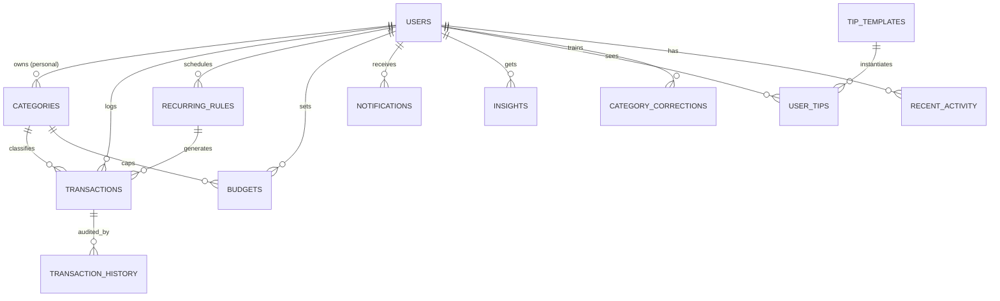

# Campus Coin — Architecture

Implements the three-tier design from SRS §1.2: **Presentation → Application/API → Data**.
Companion files: `PRD.md` (what), `design.md` (look & UX), `phases.md` (build order), `.cursorrules` (AI rules).

---

## 1. Technology Stack (SRS §1.8 approved options)

| Layer | Choice | Why |
|---|---|---|
| Language / framework | **Python 3.12 + Django 5** | Built-in auth, sessions, CSRF, password-reset tokens, ORM; one language to learn and defend to judges |
| Frontend | **HTML5, CSS3, Bootstrap 5 (customised), JavaScript + jQuery, Chart.js** via Django templates | All listed in SRS; no SPA build step. Custom CSS layer so the UI is *not* a stock template |
| Database | **MySQL 8** (SQLite allowed for local dev only) | SRS-approved relational DB |
| PDF / image export | ReportLab (PDF), Matplotlib (chart PNG) | Server-side, no downloads until user clicks |
| AI (optional) | Local rule + learning categoriser; optional LLM API for narrative insights (env-flagged) | Works with zero API keys; AI is a bonus, never a dependency |
| Email | Django email (console backend in dev, SMTP in prod) | Password reset + share report |
| Hosting | PythonAnywhere (free MySQL) or Render | Preferred: hosted URL for evaluation |

> Alternative stacks (MERN, Laravel, ASP.NET) are also valid per SRS; the *data model, endpoints and algorithms below are stack-independent*.

---

## 2. High-Level Diagram

```
┌──────────────────────────── PRESENTATION LAYER ────────────────────────────┐
│ Django templates + Bootstrap 5 + custom CSS + jQuery + Chart.js            │
│ Dashboard · Forms · Charts · Insights feed · Admin panel · Sitemap         │
└───────────────▲──────────────────────────────────────────┬────────────────┘
                │ HTML / JSON (fetch, AJAX)                │
┌───────────────┴──────────── APPLICATION / API LAYER ─────▼────────────────┐
│ Django views (thin) → services (business logic)                            │
│  Auth & sessions · Transactions · Budgets/Alerts · Reports · Tips engine   │
│  AI categoriser · Insight generator · Anomaly/forecast · Import/Export     │
└───────────────▲──────────────────────────────────────────┬────────────────┘
                │ ORM (per-user scoped querysets)          │
┌───────────────┴──────────────── DATA LAYER ──────────────▼────────────────┐
│ MySQL: users · categories · transactions · budgets · insights · tips ·     │
│        notifications · recurring_rules · audit_history · announcements     │
└────────────────────────────────────────────────────────────────────────────┘
        Optional external: LLM API (aggregates only) · SMTP server
```

**Rule:** views parse/validate → call a **service function** → return a response. No business logic in templates; no SQL in views.

---

## 3. Project Structure

```
campuscoin/
├── manage.py
├── requirements.txt
├── .env.example                 # SECRET_KEY, DB_*, EMAIL_*, AI_API_KEY (optional)
├── .cursorrules  PRD.md  architecture.md  design.md  phases.md  AI_USAGE.md
├── campuscoin/                  # project config
│   ├── settings/{base,dev,prod}.py
│   └── urls.py
├── apps/
│   ├── core/          # home page, sitemap, error pages, context processors (theme, font size), utils
│   ├── accounts/      # User model, register/login/logout, admin login, profile, reset
│   ├── ledger/        # Category, Transaction, RecurringRule, History, CSV import, recent activity
│   ├── budgets/       # Budget, Notification, alert service
│   ├── reports/       # aggregation queries, filters, PDF/image export, email share
│   ├── insights/      # Tip templates, UserTip, Insight, ai_categoriser, anomaly, forecast
│   └── control/       # custom Admin Control Panel (NOT Django admin) + stats
├── templates/         # base.html, partials/, one folder per app
├── static/{css,js,img}/
├── db/schema.sql      # generated SQL deliverable
├── db/seed/           # fixtures / management command seed_demo
└── tests/
```

---

## 4. Data Model

Money = `DECIMAL(12,2)`. All user-owned tables have `user_id` (indexed). Timestamps in UTC.

### 4.1 Tables

**users** (custom `AbstractUser`, email is the login)
| Column | Type | Notes |
|---|---|---|
| user_id (PK) | BIGINT/UUID | |
| name | VARCHAR(100) | |
| email | VARCHAR(254) UNIQUE | login |
| password_hash | VARCHAR | Django PBKDF2/Argon2 |
| role | ENUM('student','admin') | |
| academic_year | VARCHAR(30) NULL | |
| monthly_allowance_baseline | DECIMAL | |
| monthly_savings_goal | DECIMAL | |
| theme | ENUM('light','dark') | UX-1 |
| font_scale | TINYINT | 1–4, UX-2 |
| is_active | BOOL | admin can disable |
| created_at, last_login | DATETIME | |

**categories**
| Column | Type | Notes |
|---|---|---|
| category_id (PK) | INT | |
| user_id (FK NULL) | | NULL ⇒ default (admin-managed) |
| name | VARCHAR(60) | |
| type | ENUM('income','expense') | |
| is_default | BOOL | |
| icon | VARCHAR(30) NULL | e.g. bootstrap-icon name |
| is_active | BOOL | soft delete |
| UNIQUE | (user_id, LOWER(name), type) | |

**transactions**
| Column | Type | Notes |
|---|---|---|
| transaction_id (PK) | BIGINT | |
| user_id (FK) | | |
| category_id (FK) | | PROTECT on delete |
| amount | DECIMAL(12,2) | CHECK > 0 |
| type | ENUM('income','expense') | must equal category.type |
| description | VARCHAR(255) | |
| ai_suggested_category (FK NULL) | INT | AI-3 |
| ai_suggestion_source | ENUM('history','keywords','llm') NULL | |
| date | DATE | |
| recurring_rule_id (FK NULL) | | |
| is_deleted | BOOL | soft delete (TXN-4) |
| flag | ENUM('none','large','duplicate') | SYS-3 |
| created_at, updated_at | DATETIME | |
| INDEX | (user_id, date), (user_id, category_id, date), (user_id, is_deleted) | performance |

**transaction_history** (audit; keeps "full history")
`history_id, transaction_id, user_id, action ENUM('create','update','delete','restore'), before_json, after_json, changed_at`

**recurring_rules**
`rule_id, user_id, category_id, type, amount, description, frequency ENUM('weekly','monthly'), day_of_period, start_date, end_date NULL, last_generated_on NULL, is_active`

**budgets**
`budget_id, user_id, category_id, month DATE (1st of month), limit_amount` — UNIQUE `(user_id, category_id, month)`

**notifications**
`notification_id, user_id, kind ENUM('budget_near','budget_exceeded','system','announcement'), message, category_id NULL, month DATE, is_read, created_at` — UNIQUE `(user_id, kind, category_id, month)` to prevent alert spam.

**insights**
| Column | Type |
|---|---|
| insight_id (PK), user_id (FK), month DATE | |
| summary_text TEXT | narrative |
| tip_text TEXT | actionable advice |
| flags_json JSON | `[{category, pct_change, amount}]` |
| source ENUM('rules','llm') | |
| is_bookmarked BOOL, note TEXT NULL | BKM-1 |
| generated_at DATETIME | UNIQUE `(user_id, month)` |

**tip_templates** (admin-managed, ADM-2)
`template_id, code, kind ENUM('tip','announcement'), title, body_template, category_id NULL, min_savings, is_active`

**user_tips**
`user_tip_id, user_id, template_id, month, text_rendered, potential_savings DECIMAL, status ENUM('active','dismissed','pinned'), is_bookmarked, note NULL, created_at` — UNIQUE `(user_id, template_id, category_id, month)`

**announcements**
`announcement_id, title, body, starts_at, ends_at NULL, is_active, created_by`

**category_corrections** (AI learning, AI-2)
`user_id, token VARCHAR(40), category_id, count INT` — PK `(user_id, token, category_id)`

**recent_activity** (SYS-1)
`user_id, transaction_id, action ENUM('viewed','edited'), at` — keep last 20 per user.

### 4.2 Relationships (ERD)



---

## 5. Routes / Endpoints

**Public:** `/` (home + sitemap) · `/register/` · `/login/` · `/password-reset/…` (Django built-ins, 4 steps)
**Admin entry (not linked in student nav):** `/control/login/`

**Student (login required, role=student)**
| URL | Purpose |
|---|---|
| `/dashboard/` | Greeting, balance, widgets, tips, charts |
| `/transactions/` · `/transactions/new/?type=` · `/transactions/<id>/edit/` · `/delete/` · `/restore/` | CRUD + history |
| `/transactions/<id>/history/` | Audit trail |
| `/transactions/import/` (+ `/template.csv`, `/preview/`, `/confirm/`) | CSV import |
| `/recurring/` (+ new/edit/toggle) | Recurring rules |
| `/categories/` (+ new/edit/delete) | **Manage Own Categories** |
| `/budgets/` (+ set, per month) | Budget goals & progress |
| `/notifications/` (+ mark read) | In-app alerts |
| `/reports/` (+ `?from=&to=&category=&type=`) | Monthly reports |
| `/reports/export/pdf/?month=` · `/reports/export/image/?month=` · `/reports/share/` | Export & email |
| `/insights/` · `/insights/<yyyy-mm>/` · `/insights/generate/` | Insight history & generation |
| `/tips/` · `/tips/<id>/dismiss|pin|bookmark/` | Tips management |
| `/bookmarks/` | Saved tips & insights with notes |
| `/profile/` · `/settings/` | Profile, theme, font size |

**JSON endpoints (AJAX, same-origin, CSRF-protected)**
`GET /api/suggest-category/?q=` · `GET /api/dashboard/summary/` · `GET /api/reports/category/` · `GET /api/reports/trend/` · `GET /api/reports/daily/` · `GET /api/budgets/progress/` · `POST /api/theme/`

**Admin panel (role=admin)**
`/control/` (stats) · `/control/categories/` · `/control/templates/` · `/control/announcements/` · `/control/users/` (view, disable/enable, send reset)

---

## 6. Key Algorithms (business logic lives in `services.py` files)

### 6.1 Budget alerts (`budgets/services.py`)
After every transaction create/edit/delete/restore for an **expense**:
1. `spent = SUM(amount)` for user+category+month (DB aggregate).
2. `ratio = spent / limit`. If `≥ 1.0` → notification `budget_exceeded`; elif `≥ 0.8` → `budget_near`.
3. Insert-if-not-exists using the UNIQUE key → one alert per threshold per month.
4. Progress bar colours: <100% coin-gold "under budget", ≥100% red "over budget"; the savings-goal card is coin-gold "under goal" / "under budget" and never red — icon + text label, never colour alone.

### 6.2 Recurring entries (`ledger/services.py`)
- Management command `generate_recurring` (cron / on-login catch-up): for each active rule, create missing transactions from `last_generated_on` to today; clamp day 29–31 to month end; update `last_generated_on`. Idempotent.

### 6.3 AI categoriser (`insights/ai_categoriser.py`) — optional, works offline
```
suggest(user, description):
  tokens = normalise(description)              # lowercase, strip digits/punct, drop stopwords
  1. history/corrections: score categories from category_corrections + user's past
     transactions containing the tokens (naive-Bayes-style count ratio)
  2. keyword dictionary (defaults): cafe|canteen|pizza|kfc|foodpanda→Food,
     uber|careem|bus|metro|fuel→Transport, netflix|spotify|youtube→Subscriptions, ...
  3. optional LLM fallback if AI_API_KEY set and confidence < 0.5 (timeout 3 s, send description only)
  return {category_id, confidence, source} or None
on save: if user's final category ≠ suggested → increment category_corrections for each token
```
Only ever *suggests*; UI pre-selects but never locks. Confidence < 0.4 ⇒ no suggestion.

### 6.4 Saving-tips engine (`insights/tips.py`) — TIP-1/2/3
For the current month, per expense category compute:
`avg3 = mean of previous 3 full months`, `projected = spent_so_far / days_elapsed × days_in_month`.
Rules (each renders an admin-editable template):
| Rule | Trigger | Potential savings |
|---|---|---|
| Over-trend | `projected > 1.15 × avg3` (and `avg3 ≥ min`) | `projected − avg3` |
| Budget pace | spent > 80% of budget before day 21 | `projected − limit` |
| Top-category | top category > 40% of expenses | `10% of its spend` |
| Subscriptions | subscriptions total > 10% of income | `20% of subs total` |
| Savings gap | `income − expense < monthly_savings_goal` | `goal − current saving` |
| Weekend spike | weekend avg/day > 1.5× weekday avg/day | `(weekend − weekday) × weekend_days_left` |
Sort by `potential_savings` desc; persist to `user_tips`; dashboard shows top 3 with status `active|pinned` (pinned first). Dismissed tips are not regenerated that month.

### 6.5 Monthly insight (`insights/insight_service.py`) — INS-1..4
1. Build **facts** (aggregates only): totals, top 3 categories, % change vs user's 3-month average per category, biggest single expense, budget breaches.
2. Flag categories with `% change ≥ +25%` and absolute increase above a small floor.
3. **Narrative:** template-based by default; if `AI_API_KEY` set, send *only the facts JSON* (no descriptions/emails) to the LLM with a "friendly, ≤120 words, non-certified advice" prompt; on any failure fall back to template.
4. Advice tied to the top flag (e.g. weekly cap = avg3 / 4.3).
5. Save to `insights` (UNIQUE user+month; regenerate overwrites). Always show disclaimer: *"Suggestions only — not financial advice."*

### 6.6 Anomaly & duplicate detection (`insights/anomaly.py`) — SYS-3
- **Large:** amount > `mean + 3·σ` of user's transactions in that category (≥5 samples) **or** > 3× the category median.
- **Duplicate:** same user, amount, category, date and normalised description already exists (or within 2 minutes).
- Set `flag`; UI shows a warning badge and "Not a duplicate" dismiss action.

### 6.7 Forecast (`insights/forecast.py`) — SYS-2
Per category: `0.5·m1 + 0.3·m2 + 0.2·m3` (last three months) + active recurring rules due next month. Show as dashed bar with label "Estimate".

### 6.8 Reports (`reports/queries.py`)
Everything is one `GROUP BY` query per view (`TruncDay/TruncWeek/TruncMonth`), never Python loops over all rows. Filters shared via one `ReportFilterForm`.

### 6.9 CSV import (`ledger/importer.py`)
Columns: `date,type,category,amount,description`. Limits: ≤1 MB, ≤2 000 rows, UTF-8, `.csv` only. Steps: parse → validate each row (collect errors) → suggest categories for missing/unknown → **preview** → user confirms → bulk insert in one DB transaction. Cells starting with `= + - @` are neutralised on export/echo to prevent CSV/formula injection.

---

## 7. Security Design

| Threat | Control |
|---|---|
| Access to others' data | Every model has `.objects.for_user(request.user)`; **never** `Model.objects.get(pk=…)` without user scope; tests assert 404 on cross-user access |
| Session theft/fixation | Secure, HttpOnly, SameSite=Lax cookies; session rotated on login; idle timeout 30 min; logout flushes |
| Brute force | Login rate-limit (e.g. `django-axes`: 5 fails → 15 min lock) |
| Password storage | Django hashers; validators (min 8, not common, not numeric only) |
| Password reset abuse | Django tokens (single-use, expire 1 h); same response whether email exists or not |
| CSRF / XSS / SQLi | CSRF tokens on all POST/AJAX; template auto-escaping; ORM parameterised queries; no `|safe` on user text |
| Malicious uploads | Extension + size + parse checks; never executed; not stored after import |
| Admin separation | `role=admin` decorator on `/control/*`; admin cannot open student transaction pages; admin login rate-limited separately |
| Secrets | `.env` only, never committed; `DEBUG=False` in prod; `ALLOWED_HOSTS` set; HTTPS + HSTS |
| AI privacy | Only aggregates/description text leave the server, never emails or names; feature off by default |

---

## 8. Frontend Architecture
- `base.html` (nav, breadcrumbs block, theme + font-scale applied from user settings **before first paint** to avoid flash), `partials/` for cards, forms, alerts, tip card, progress bar.
- CSS: Bootstrap 5 utilities + `static/css/campuscoin.css` with design tokens (see `design.md`). No copied theme.
- JS modules (`static/js/`): `theme.js`, `quickadd.js` (debounced suggest call), `charts.js` (Chart.js wrappers + loading skeletons), `budgets.js`, `csv-preview.js`. Progressive enhancement: every form works without JS.
- Charts always ship with an accessible `<table>` alternative and `aria-label`.

---

## 9. Deployment & Operations
- **Environments:** dev (SQLite/MySQL, console email) → prod (MySQL, SMTP, HTTPS).
- **Config:** `.env` → settings; `requirements.txt` pinned.
- **Scheduled jobs:** `generate_recurring` daily; optional `generate_insights` on the 1st of each month.
- **Backups:** nightly `mysqldump` (documented in install guide); restore steps tested once.
- **Logging:** Django logging to file; no sensitive data in logs.
- **Static/media:** `collectstatic` + WhiteNoise.

---

## 10. Testing Strategy
| Level | Focus |
|---|---|
| Unit | services: budget thresholds, recurring generation, tips ranking, categoriser, anomaly, forecast, CSV parser |
| Integration | auth flows, CRUD + history, report queries, export endpoints return correct content-type |
| Security | cross-user access → 404/403, disabled user blocked, reset token reuse fails, CSV injection neutralised |
| UI/manual | Checklist per requirement ID in `PRD.md`; responsive check at 360/768/1280 px; keyboard-only run; Lighthouse |
| Test data | `seed_demo` command: 1 admin, 3 students, 6 months of realistic transactions, budgets, recurring rules, sample CSV |
